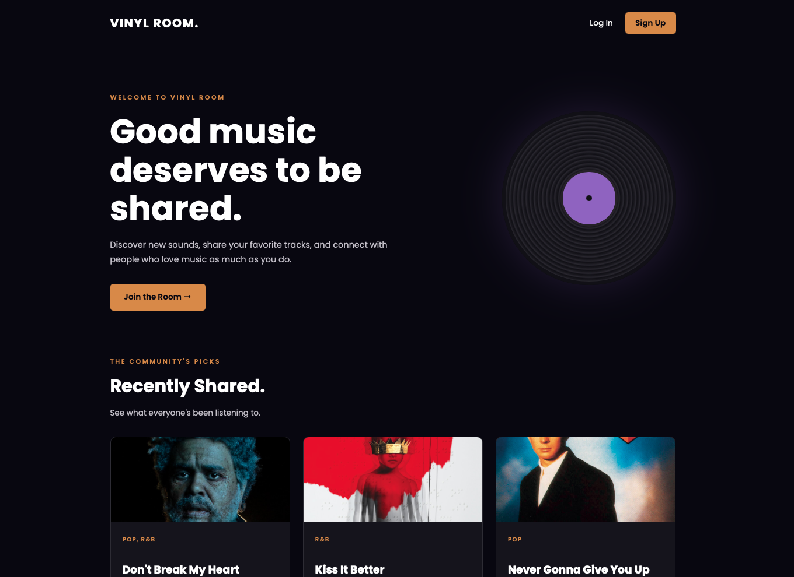

# 🎵 Vinyl Room

**Discover music. Share your favorites. Find your next favorite track.**

Vinyl Room is a full-stack music discovery and sharing application where users can recommend songs, explore music shared by others, and upvote their favorite recommendations.

Built with Node.js, Express, MongoDB, and EJS, Vinyl Room integrates the Spotify Web API to automatically retrieve album artwork for shared tracks.

## 🔗 Live Application

[Explore Vinyl Room](https://vinyl-room.onrender.com/)

## 📸 Project Preview



## Features

- **User Authentication:** Sign up, log in, and access a personal profile.
- **Share Music:** Recommend songs with titles, artists, albums, genres, and personal descriptions.
- **Spotify Integration:** Automatically retrieve album artwork for matching tracks.
- **Music Discovery:** Browse recommendations shared by the community.
- **Upvoting:** Upvote songs, remove votes, and see recommendation scores.
- **Personal Collection:** View and manage your shared recommendations.
- **Post Management:** Delete your own song recommendations.
- **Responsive Design:** Custom dark-themed interface for desktop and mobile.

## Tech Stack

### Frontend
- HTML5
- CSS3
- JavaScript
- EJS

### Backend
- Node.js
- Express.js
- MongoDB
- Mongoose
- Passport.js

### APIs & Deployment
- Spotify Web API
- MongoDB Atlas
- Render
- Git & GitHub

## How It Works

1. **Create an account** to start sharing music.
2. **Share a song** by entering its title, artist, genre, and other details.
3. **Spotify automatically retrieves album artwork** when a matching track is available.
4. **Explore the discovery feed** to find songs shared by other users.
5. **Upvote recommendations** you enjoy, or remove your upvote at any time.
6. **Visit your profile** to view and manage your shared collection.

## Getting Started

### Prerequisites

- Node.js 18 or newer
- MongoDB Atlas database
- Spotify Developer application credentials

### Installation

1. Clone the repository:

   ```bash
   git clone https://github.com/YOUR_USERNAME/vinyl-room.git
   cd vinyl-room
   ```

2. Install dependencies:

   ```bash
   npm install
   ```

3. Create a `.env` file in the project root and configure the environment variables used by your MongoDB connection, Passport session, and Spotify integration.

   For Spotify:

   ```env
   SPOTIFY_CLIENT_ID=your_spotify_client_id
   SPOTIFY_CLIENT_SECRET=your_spotify_client_secret
   ```

   Make sure to use the correct environment variable names for your database connection and session secret.

4. Start the development server:

   ```bash
   npm run dev
   ```

5. Open **http://localhost:3000** in your browser.

## Future Improvements

- Sort recommendations by most recent or most upvoted.
- Search and filter songs by artist, title, or genre.
- Explore public user profiles and their music collections.
- Improve Spotify track matching for remixes, live versions, and alternate releases.

## About the Project

I built Vinyl Room to explore the intersection of music discovery and community-driven recommendations while expanding my experience with full-stack development.

The project gave me the opportunity to work with user authentication, RESTful routing, MongoDB data relationships, third-party API integration, and dynamic server-rendered interfaces.

Rather than building a traditional music player, I wanted to create a space centered around sharing music and discovering tracks through other people's recommendations.